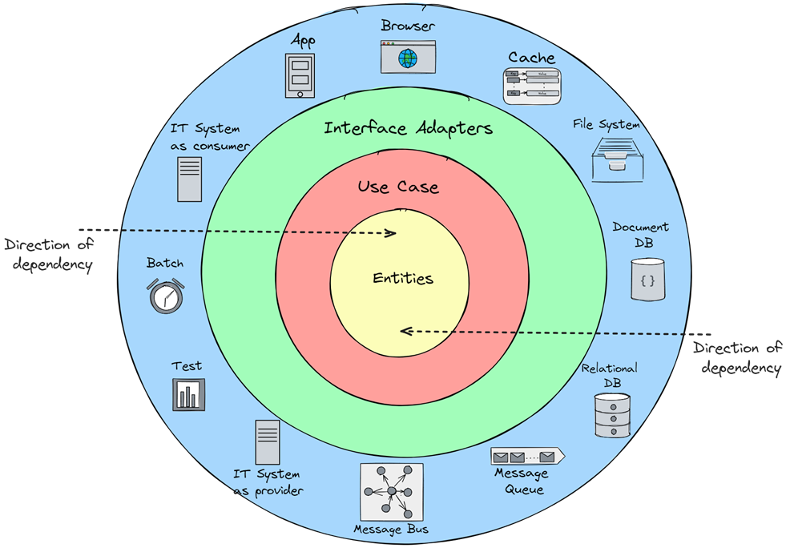
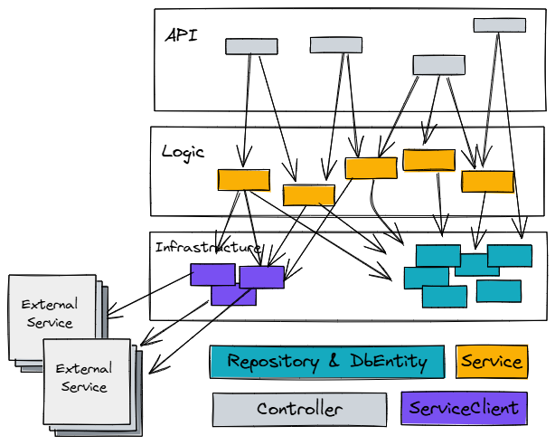

# The Fundamentals That Matter

In today’s fast-paced world of software development, maintainability and adaptability  
are no longer “nice-to-haves” – they are essential for survival.  
As project size and complexity grow and requirements continuously change,  
software architecture must evolve accordingly. For developers aiming to build scalable, testable,  
and sustainable solutions, **Clean Architecture** provides a strong foundation.

But what exactly does it mean? And how can it be applied effectively without overengineering?  
Let’s take a closer look.

---

## 🧱 What Is Clean Architecture?

Clean Architecture, popularized by Robert C. Martin, is an architectural pattern based on the 
**strict separation of business logic and technical concerns**.  
Its goal is to eliminate dependencies on frameworks, databases, file systems, message brokers,  
and other infrastructure components, enabling a long-term flexible architecture.

Clean Architecture is structured as a **concentric ring model** (Fig. 1), where each ring has a clear responsibility:

| Ring                                                                                  | Description                                                                                                                                                                                                                |
|---------------------------------------------------------------------------------------|----------------------------------------------------------------------------------------------------------------------------------------------------------------------------------------------------------------------------|
| Entities                                                                              | Contains business objects, rules, and logic.                                                                                                                                                                               |
| Use Cases                                                                             | Definition of the application interfaces, enforcement of use-case-specific business rules, and implementation of the control flow for each use case.                                                                   |
| Interface Adapters | Integrate technical components and adapt them to the business application, composed of Use Cases and Entities Ring. Typical interface adapters are Controller, Mapper, Repositories, Service Clients, Gateways, and so on. |
| Frameworks \& Drivers | The outermost ring, containing framework and infrastructure components integrated by the Interface Adapters. Typical technical components are HTTP, Database, Message Broker, File System, Cache, Drivers, and so on.      |

> **The Golden Rule:** 
> 
> **Dependencies** always point **inward**, to the **core of the ring model**!
> 
> The most inner ring in clean architecture is the Entities ring. 
> 
> In other words: The business application (Use Cases and Entities ring) is not allowed to depend on frameworks, databases, or other technical components.



---

## 💡 Clean Architecture vs. Horizontal Layered Architecture

The **horizontal layered architecture** (Fig. 2) has long dominated enterprise application design.  
Even today, it remains widely used — including in greenfield projects.



This pattern works well for systems with low complexity.  
Its simplicity allows rapid initial progress, assuming that requirements are well known and stable.

However, in more complex systems, a tight coupling often arises between business logic and technical code.  
This increases code complexity and makes maintenance and extensibility harder — and more expensive — over time.

Coupling to frameworks and infrastructure components becomes visible in the code, for example through:

- JPA, REST, or other annotations that integrate technical components into classes containing business objects and business logic.
- Business logic in repositories.
- Validation and business rules in controllers.
- Database access inside the entity model.
- Protocol handling mixed with business logic.

Clean Architecture deliberately enforces stronger separation.  
It combines several proven design principles into a cohesive and consistent architectural model, including:

- **Single Responsibility Principle:** Each class has one and only one reason to change.
- **Separation of Concerns:** Each module has a single, clear functional responsibility.
- **Dependency Inversion Principle:** Dependencies point to abstractions, not to concrete implementations.
- **Interface Segregation Principle:** Many specific interfaces are better than one generic one.
- **Ports and Adapters:** The business application is isolated from the outside world via well-defined ports (interfaces).  
  External adapters implement or consume these ports.

---

## Modeling a Use Case in Clean Architecture

The example application models processes within a car dealership,  
with garage order management as core domain.

The `GarageOrder` is a key business object (entity) designed to support several use cases, such as:

- Creating a new order
- Capturing and updating order details
- Adding or removing order positions
- Updating the order status
- Assigning the order to an employee
- Linking the order to a customer and vehicle
- Completing or canceling an order

These use cases represent the **behavior** of the business object.  
In addition, each business object contains:

- **Attributes**, such as an order number (`OrderNumber`) or order state (`OrderState`)
- **Business rules**, such as verifying that only valid state transitions are performed in the correct order

The `GarageOrder` entity encapsulates behavior, attributes, and rules, and resides within the Entities ring (Fig. 3).


The use case “Create a new order” is represented in the Use Cases ring by the interface  
`CreateGarageOrder`. Its implementation, `CreateGarageOrderInteractor`,  
also lives within the Use Cases ring.  
The interactor coordinates the creation of a new order by using the `GarageOrder` entity  
to construct a new instance and enforce the necessary business rules.

It then uses a repository interface (`SaveGarageOrder`) to persist the new order.  
This repository interface acts as a **Use Case Output Port** resides in the Use Cases ring.

By distinguishing between **Use Case Input Ports** and **Use Case Output Ports**,  
the application is conceptually divided into:

- An **incoming side** – consumers use the application through a technical channel.
- An **outgoing side** – the application interacts with external technical components through a technical channel.

The Use Case Interactor connects these two sides by  
**implementing an input port** and, during its execution flow, **using output ports**.  
Managing this **Flow of Control** is the interactor’s primary responsibility (Fig. 4).


The concrete repository implementation (`GarageOrderRepository`)  
resides in the Interface Adapters ring.  
It implements the `SaveGarageOrder` output port and uses a JPA as library  
to persist the `GarageOrderDbEntity` in the database. The `GarageOrderDbEntity`
is the adapter model for the persistence adapter.

At this point, the adapter must perform the transformation between  
the business entities and the adapter model.  
It is good practice to encapsulate this transformation logic in a dedicated **Mapper** class.

The `GarageOrderRepository` is thus an outgoing interface adapter.  
An example of an incoming adapter would be a REST controller  
that handles HTTP requests for creating new orders.  
The `GarageOrderController` uses the input port `CreateGarageOrder`  
to trigger the use case execution and also employs a mapper class  
to transform between the adapter and entity models (Fig. 5).

To comply with the **golden rule of dependency direction** —  
dependencies must always point toward the inner rings —  
and to implement a **technology-agnostic application**,  
three key concepts are applied:

1. **Adapter Model:** Represents data structures used by adapters (e.g., REST resources, database entities).  
   They are technology-specific and should not appear in the domain.
2. **Mapper:** Responsible for converting between adapter and entity models,  
   isolating the Use Cases and Entities ring from technical details.
3. **Ports & Adapters:** Adapters implement or consume the application’s input and output ports,  
   following the **Dependency Inversion Principle**, ensuring that dependencies always point inward toward the core application.


This example illustrates how Clean Architecture enforces a **clear separation between business and technology**.

Fig. 6 summarizes the pattern language of Clean Architecture.


---

## ⚙️ Structuring with Packages

The package structure in Listing 1 maps the Clean Architecture rings into packages.  
The distinction between input and output adapters and use cases is represented by subpackages “in” and “out.”  
This approach is called **Architecturally Expressive** because the code structure clearly reflects the architecture.

```
|-- de.arkem.javapro.cleanarc
    |-- adapters
    |    |-- in
    |    |  |-- GarageOrderController.java
    |    |  |-- GarageOrderResource.java
    |    |  |-- GarageOrderToResourceMapper.java
    |    |-- out
    |    |  |-- GarageOrderRepository.java
    |    |  |-- GarageOrderDbEntity.java
    |    |  |-- GarageOrderToDbEntityMapper.java
    |-- usecases
    |    |-- in
    |    |  |-- CreateGarageOrder.java
    |    |-- interactor
    |    |  |-- CreateGarageOrderInteractor.java
    |    |-- out
    |    |  |-- SaveGarageOrder.java
    |-- entities
    |    |-- GarageOrder.java
```
[Listing 1: Package structure and classes in Clean Architecture by example]()

---

## 🧭 When Does Clean Architecture Make Sense?

Clean Architecture is particularly valuable when:

- Your application needs to remain maintainable and extendable over time.
- You require testable, robust business logic.
- You want to minimize dependencies on frameworks and infrastructure.
- You need flexibility and adaptability when changing technologies.

⚠️ **Note:** For simple CRUD applications, Clean Architecture can be overkill.

---

## 🧪 Further Reading

- [The Clean Architecture – Robert C. Martin (Uncle Bob)](https://blog.cleancoder.com/uncle-bob/2012/08/13/the-clean-architecture.html)

---

## 🧭 What’s Next?

After establishing the fundamentals of Clean Architecture, the next article explores **vertical slicing**, **tactical Domain-Driven Design**,  
and how these concepts connect with Clean Architecture. Together, they form a modern implementation approach that enables  
the continuous evolution of software systems throughout their entire lifecycle.

---
